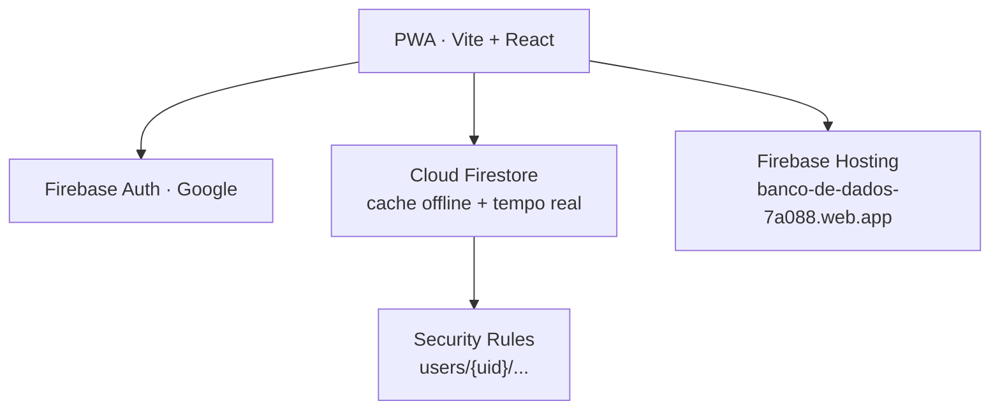

<div align="center">
  
  <h1>Banco de Aulas</h1>
  <p><strong>Controle pessoal de banco de horas docentes, medido em aulas.</strong></p>
  <p>PWA multiusuário com login Google, sincronização em tempo real e suporte offline.</p>

  <p>
    <a href="https://banco-de-dados-7a088.web.app"></a>
    <a href="https://github.com/giuliovalcanaia/banco-de-aulas/actions/workflows/firebase-deploy.yml"></a>
    
    
    
    
    
  </p>

  <p>
    <a href="https://banco-de-dados-7a088.web.app"><strong>▶ Acessar o app</strong></a>
  </p>
</div>

---

## Sobre

**Banco de Aulas** é um aplicativo web (PWA) para professores controlarem o próprio
banco de horas sem depender de planilhas. O saldo é sempre expresso em **aulas**,
que é a unidade real do dia a dia docente.

A jornada padrão é de segunda a sexta, das **07:15 às 11:15** e das **13:00 às
17:00**, com 15 minutos de lanche em cada período (09:30–09:45 e 15:15–15:30).
Isso dá **7h30 efetivas = 10 aulas de 45 minutos**. Só os dias divergentes são
lançados: um dia sem registro vale a jornada padrão, com saldo zero.

Os dados ficam no **Cloud Firestore** e o acesso é protegido por **login Google**
via Firebase Auth. Cada usuário enxerga **apenas os próprios dados**
(`users/{uid}/...`), com isolamento garantido pelas Security Rules — não apenas
pelo cliente. O app funciona **offline** e sincroniza quando a conexão volta.

> [!NOTE]
> Os valores de configuração do Firebase são públicos por natureza. A autorização
> e o isolamento entre contas ficam em [`firestore.rules`](firestore.rules), e não
> em segredos no repositório.

## Funcionalidades

- **Registro do dia** — o formulário já vem preenchido com a jornada padrão;
  altere só o que divergiu, remova um período para marcar folga ou salve direto.
  A data pode ser trocada pelo calendário ou pelo botão **Hoje**.
- **Histórico** — lista apenas os dias lançados, agrupados por mês, com o saldo de
  cada dia e o subtotal do mês. Permite editar e excluir; ao editar, mudar a data
  **move** o lançamento.
- **Contador de saldo** — pílula no cabeçalho no celular e cartão fixo no desktop,
  mostrando o saldo em aulas, o equivalente em horas e a estimativa em dias de
  folga.
- **Ajustes** — personaliza jornada padrão, duração da aula e dias úteis; exporta e
  importa backup em JSON; apaga todos os dados e mostra a conta logada.
- **Sincronização em tempo real** — múltiplos dispositivos refletem as mudanças
  na hora, com fila de escrita offline.
- **Tema claro/escuro** — alternável no cabeçalho, salvo em `localStorage`, com o
  tema do sistema como padrão na primeira visita.
- **Multiusuário** — qualquer conta Google verificada entra e gerencia o próprio
  banco de horas.
- **Sessão de 30 dias** — validada no cliente e reforçada nas Security Rules.

### Instalar no celular (PWA)

| Plataforma | Passos |
| --- | --- |
| **Android / Chrome** | Menu ⋮ → **Instalar app** |
| **iPhone / Safari** | **Compartilhar** → **Adicionar à Tela de Início** |

O app abre offline com os últimos dados em cache. Criar, editar e excluir também
funcionam offline; o Firestore envia tudo quando a conexão volta. A instalação
exige HTTPS (o Firebase Hosting já fornece).

## Como funciona o cálculo

```text
minutos do dia   = (manhã − lanche) + (tarde − lanche)
saldo do dia     = minutos do dia − jornada padrão (450 min)
saldo em aulas   = saldo do dia ÷ 45
saldo total      = soma dos lançamentos
```

Os intervalos de lanche (09:30–09:45 e 15:15–15:30) não entram na contagem. Como um
dia sem lançamento vale zero, o total é sempre a soma dos dias registrados. Folga é
um lançamento sem períodos e desconta 10 aulas. As regras ficam em
[`src/lib/time.ts`](src/lib/time.ts) e [`src/lib/schedule.ts`](src/lib/schedule.ts).

## Stack

| Camada | Tecnologias |
| --- | --- |
| **Front-end** | React 19, TypeScript, Vite 8 |
| **UI** | Tailwind CSS v4, shadcn/ui (Radix), lucide-react, sonner |
| **Dados** | Firebase Auth (Google), Cloud Firestore (cache offline persistente) |
| **Entrega** | Firebase Hosting + PWA (manifest + service worker) |
| **Qualidade** | oxlint, Vitest, `@firebase/rules-unit-testing` |

## Arquitetura



- A sessão dura **30 dias**, validada no cliente (`auth_time`) e nas Security Rules.
- O Firestore guarda os dados por usuário (`users/{uid}/...`).
- O service worker cuida apenas do shell e dos assets — não intercepta Firestore
  nem Auth.
- Deploy e infraestrutura detalhados em **[DEPLOY.md](DEPLOY.md)**.

## Como rodar

**Pré-requisitos:** Node.js 22+ e, para os emuladores, Java.

```bash
npm install
npm run dev
```

Crie o `.env.local` a partir do modelo:

```bash
cp .env.example .env.local
```

```bash
VITE_FIREBASE_API_KEY=
VITE_FIREBASE_AUTH_DOMAIN=SEU_PROJETO.firebaseapp.com
VITE_FIREBASE_PROJECT_ID=SEU_PROJETO
VITE_FIREBASE_STORAGE_BUCKET=SEU_PROJETO.firebasestorage.app
VITE_FIREBASE_MESSAGING_SENDER_ID=
VITE_FIREBASE_APP_ID=
```

### Emuladores locais

```bash
npm run emulators          # Auth + Firestore (+ UI) em outro terminal
VITE_USE_FIREBASE_EMULATOR=true npm run dev
```

A UI do emulador de Auth fica em `http://127.0.0.1:4000`, onde você cria usuários
de teste.

## Scripts

| Comando | Descrição |
| --- | --- |
| `npm run dev` | Servidor de desenvolvimento |
| `npm run build` | Typecheck + build de produção |
| `npm run preview` | Pré-visualização do build estático |
| `npm run lint` | Lint com oxlint |
| `npm test` | Testes unitários (Vitest) |
| `npm run test:watch` | Testes em modo watch |
| `npm run test:rules` | Security Rules no emulador do Firestore |
| `npm run emulators` | Auth + Firestore + UI locais |
| `npm run test:notif` | Script auxiliar de notificação |

## Testes

A suíte cobre as regras de cálculo e a lógica de sessão (Vitest) e valida as
Security Rules contra o emulador do Firestore com `@firebase/rules-unit-testing`
— incluindo isolamento entre usuários, validação de documentos e a expiração de
30 dias.

```bash
npm test          # unitários: cálculo e sessão
npm run test:rules # Security Rules (exige emulador)
```

## Estrutura

```text
src/
├── components/       # UI (inclui shadcn/ui em components/ui)
├── hooks/            # estado, autenticação, sincronização e tema
├── lib/              # cálculo, Firebase, Firestore, armazenamento e auth
└── App.tsx
public/               # manifest, service worker e ícones do PWA
tests/                # testes das Security Rules
firestore.rules       # autorização e validação
firebase.json         # Hosting, headers/CSP, Firestore e emuladores
.github/workflows/    # deploy automático somente na main
```

## Modelo de dados

```text
users/{uid}/entries/{YYYY-MM-DD}
  date, morning, afternoon, note, updatedAt

users/{uid}/settings/main
  defaultMorning, defaultAfternoon, minutesPerAula, workdays, schemaVersion, updatedAt
```

- O ID do documento de entrada é a própria data, o que impede duplicatas.
- O navegador mantém um cache de leitura/escrita offline do Firestore.
- **Ajustes → Exportar JSON** gera uma cópia completa do banco de horas.

## Segurança e privacidade

- Login com qualquer conta Google **verificada**; cada usuário acessa somente
  `users/{uid}/...` (isolamento imposto pelas Security Rules).
- O Firestore valida `uid`, verificação de e-mail e validade da sessão.
- Sessão de 30 dias aplicada via `auth_time`, no cliente e nas Rules.
- Cache local persistente; ao sair, o app limpa o cache do Firestore.
- Não há servidor próprio de dados nem analytics.
- Para revogar o acesso de alguém, remova o usuário no Firebase Auth.

## Deploy

O deploy é automático: **push na `main`** dispara o GitHub Actions, que roda lint,
testes e build antes de publicar o Hosting e as Security Rules. A branch `dev` não
publica.

As instruções completas (service account, variáveis, deploy manual, migração e
checklist) estão em **[DEPLOY.md](DEPLOY.md)**.
